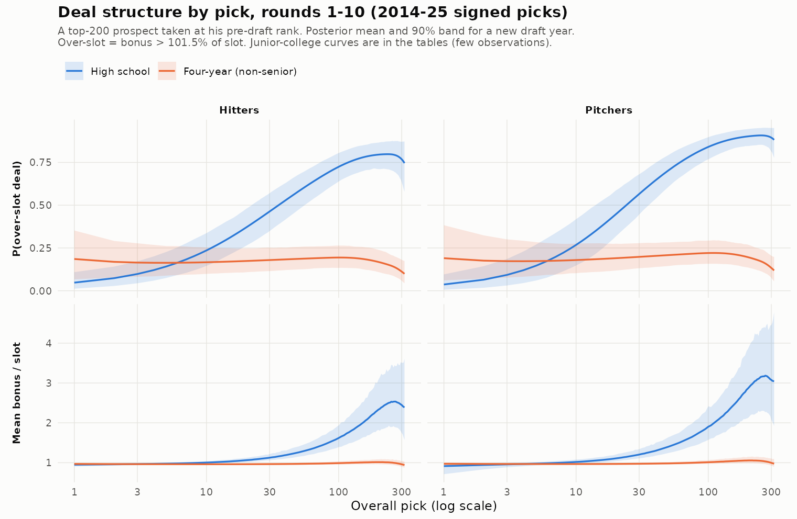
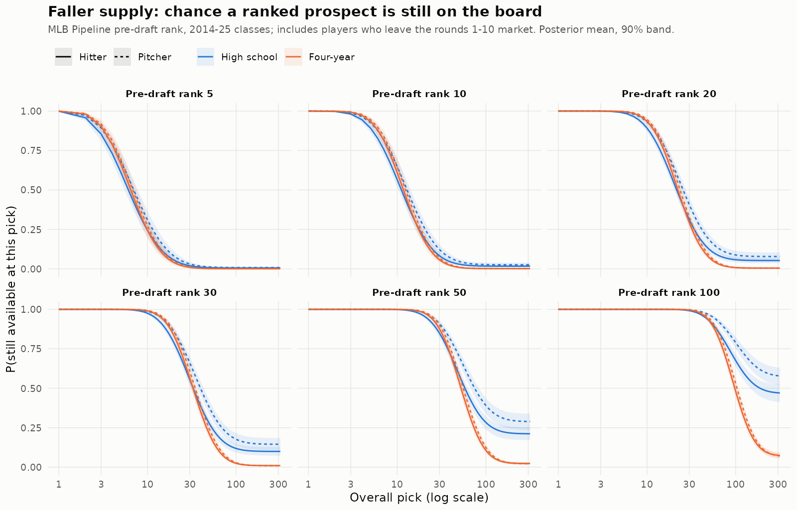
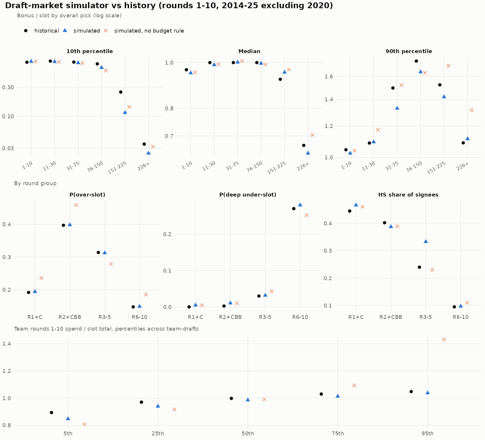

```{r setup, include = FALSE}
knitr::opts_chunk$set(echo = TRUE, message = FALSE, warning = FALSE, fig.align = "center", dpi = 150)
suppressPackageStartupMessages({
  library(dplyr); library(tidyr); library(readr); library(ggplot2); library(scales); library(knitr)
})

# All results are read from the pipeline's committed checkpoint tables; nothing below refits a model.
ck <- function(stage, name) read_csv(file.path("data/derived", stage, paste0(name, ".csv")), show_col_types = FALSE)
m  <- function(x, d = 1) formatC(round(x / 1e6, d) + 0, format = "f", digits = d)          # $ -> "$M" text
pc <- function(x, d = 0) paste0(formatC(100 * x, format = "f", digits = d), "%")
rng <- function(x, d = 1) paste0(m(min(x), d), "–", m(max(x), d))
ci  <- function(lo, hi, d = 1) paste0("(", m(lo, d), " to ", m(hi, d), ")")

# Source excerpts are read from the repository files at render time, so the code shown is the code that ran.
excerpt <- function(file, from, to, lang = "", extra = 0) {
  x <- readLines(file)
  i <- grep(from, x)[1]; j <- i - 1 + grep(to, x[i:length(x)])[1] + extra
  stopifnot(!is.na(i), !is.na(j))
  y <- x[i:j]; ind <- min(nchar(y[nzchar(trimws(y))]) - nchar(trimws(y[nzchar(trimws(y))], "left")))
  cat(sprintf('<p class="src">%s, lines %d–%d</p>\n\n', file, i, j))
  cat("```{.", lang, " .fold-show}\n", paste(substring(y, ind + 1), collapse = "\n"), "\n```\n\n", sep = "")
}

theme_pool <- function() theme_minimal(base_size = 11) +
  theme(panel.grid.minor = element_blank(), plot.title = element_text(face = "bold", size = 12),
        plot.subtitle = element_text(colour = "grey35"), legend.position = "bottom", strip.text = element_text(face = "bold"))
theme_set(theme_pool())
type_cols <- c(`HS-H` = "#1f5fa8", `HS-P` = "#7fb0e6", `4yr-H` = "#c4501b", `4yr-P` = "#efa47a", `JUCO-H` = "#167a5c", `JUCO-P` = "#84cdb4")
accent <- "#c4501b"
# kable wrapper: escape "$" so pandoc does not read "$M ... $M" in headers or cells as inline math
kbl <- function(x, ...) {
  esc <- function(v) gsub("$", "\\$", v, fixed = TRUE)
  names(x) <- esc(names(x)); x[] <- lapply(x, function(v) if (is.character(v)) esc(v) else v)
  kable(x, ...)
}
```

```{css, echo = FALSE}
p.src { font-size: 0.8em; color: #6c757d; margin-bottom: -0.6em; font-family: monospace; }
.callout { border-left: 4px solid #c4501b; background: #fbf4ef; padding: 0.8em 1.1em; margin: 1em 0; }
.callout p:last-child { margin-bottom: 0; }
table { font-size: 0.9em; }
```

```{r load}
# inputs
picks   <- read_csv("data/derived/picks_clean.csv", show_col_types = FALSE)
rules   <- read_csv("data/derived/rules_by_year.csv", show_col_types = FALSE)
curves  <- ck("checkpoint5", "curves_2012_21")
diag4   <- ck("checkpoint4", "diagnostics");  diag5 <- ck("checkpoint5", "diagnostics"); diag6 <- ck("checkpoint7", "signing_diagnostics")
oot_arr <- ck("checkpoint4", "oot_arrival_by_bonus_decile")
oot_val <- ck("checkpoint4", "oot_value_tiers_ordinal")
acc_oot <- ck("checkpoint5", "accrual_oot_tiers")
imp_sum <- ck("checkpoint5", "imputation_summary")
loo     <- ck("checkpoint4", "loo_compare_tier")
deal_ppc <- ck("checkpoint5", "deal_ppc")
sim_rb  <- ck("checkpoint5", "sim_val_by_round"); sim_ut <- ck("checkpoint5", "sim_val_utilization")
sim_rk  <- ck("checkpoint5", "sim_val_ranked_taken"); sim_rp <- ck("checkpoint5", "sim_val_ratio_by_pick")
sign_eff <- ck("checkpoint7", "signing_effects"); sign_rates <- ck("checkpoint7", "signing_cell_rates")
fail_m  <- ck("checkpoint7", "signing_fail_model"); unsigned_why <- ck("checkpoint7", "unsigned_reasons")
pol     <- ck("checkpoint7", "policies_by_position")
q3      <- ck("checkpoint7", "q3_by_position"); q3f <- ck("checkpoint7", "q3_first_pick")
exch    <- ck("checkpoint7", "exchange_rate"); q4 <- ck("checkpoint7", "q4_overage")
i2      <- ck("checkpoint7", "i2_benchmark"); hold <- ck("checkpoint7", "holdout")
risk    <- ck("checkpoint7", "risk_player_level"); comp <- ck("checkpoint7", "pick_composition")
v_sens  <- ck("checkpoint7", "valuation_sensitivity"); s_sens <- ck("checkpoint7", "signing_risk_variants")
sup     <- ck("checkpoint7", "supply_sensitivity"); q6 <- ck("checkpoint7", "q6_time_assets")
xpick   <- ck("checkpoint7", "extra_pick"); depth <- ck("checkpoint7", "depth_split")

best_adaptive <- function(d, by = "p") d |> filter(grepl("^adaptive", policy)) |> group_by(across(all_of(by))) |>
  slice_max(gain, n = 1, with_ties = FALSE) |> ungroup()

# headline numbers used in the text
q3 <- q3 |> mutate(pct = adaptive_gain / bpa_surplus, save_share = 1 - adaptive_first_ratio)
first_at_slot <- q3f |> filter(s1 == 0) |> select(p, cont_gain = gain)
save_comp <- q3f |> group_by(p) |> slice_max(gain_vs_first_at_slot, n = 1, with_ties = FALSE) |> ungroup() |>
  select(p, s1_best = s1, save_gain = gain_vs_first_at_slot, save_lo = gain_vs_first_at_slot_lo, save_hi = gain_vs_first_at_slot_hi,
         save_ppos = p_pos_vs_first_at_slot) |> left_join(first_at_slot, by = "p")
i2_best <- best_adaptive(i2)
static_best <- pol |> filter(class %in% c("save-at-top", "spend-at-top", "barbell", "spread")) |> group_by(p) |>
  slice_max(gain, n = 1, with_ties = FALSE) |> ungroup()
ad_r <- risk |> filter(grepl("105", policy))
K <- list(
  n_picks = nrow(picks), yrs = range(picks$year),
  n_arr = sum(imp_sum$n_arrivals),
  dvdb_300k = curves |> filter(abs(log(bonus / 3e5)) == min(abs(log(bonus / 3e5)))) |> pull(dV_dB),
  dvdb_7m = curves |> filter(abs(log(bonus / 7e6)) == min(abs(log(bonus / 7e6)))) |> pull(dV_dB),
  p1 = q3 |> filter(p == 1), p40 = q3 |> filter(p == 40),
  holdout = hold$gain, static_max = max(static_best$gain),
  i2_max = max(i2_best$gain), i1_min = min(q3$adaptive_gain)
)
n_big <- picks |> filter(year <= 2021, signed %in% TRUE, !is.na(bonus_pv)) |> summarise(n = sum(bonus_pv * sched_to_2025 > 5e6)) |> pull(n)
```

<div class="callout">

**Summary.** One conclusion I drew from working in an MLB draft room this July is that teams across the league are leaving copious value on the table by not being more statistically rigorous in how they choose to spend the bonus pool. In this independent project, I built a staged R + Stan pipeline that seeks to refine this process. The pipeline estimates what a draftee is worth as a function of the bonus he signs for, models how the draft market prices and sorts players, simulates thousands of drafts, and searches for allocation rules inside that simulated market.

* **A value-aware rule that re-optimizes at every pick beats best-player-available-at-slot (BPA) by $`r rng(q3$adaptive_gain)`M of expected class surplus at every first-round position** (`r pc(min(q3$pct))`–`r pc(max(q3$pct))` of BPA's surplus), with the 90% posterior band above zero everywhere. The gain holds on held-out scenarios and under every valuation, signing-risk and supply sensitivity I ran.
* **Fixed templates do not work.** The best "save at the top", "spend at the top", "barbell" or "spread" rule never beats BPA; even the best of them, at its best position, trails BPA by $`r m(-K$static_max, 2)`M. Moving money only helps when the player it buys is chosen by value.
* **The value curve is concave.** A marginal bonus dollar buys roughly `r formatC(min(K$dvdb_300k), format = "f", digits = 1)`–`r formatC(max(K$dvdb_300k), format = "f", digits = 1)` dollars of expected value at a \$300k bonus but `r formatC(min(K$dvdb_7m), format = "f", digits = 1)`–`r formatC(max(K$dvdb_7m), format = "f", digits = 1)` at \$7M. The optimal first pick signs for `r pc(min(save_comp$s1_best))`–`r pc(max(save_comp$s1_best))` under slot, and the savings move to hitters, younger players, college bats in rounds 3–5 and over-threshold high-schoolers after round 10.
* **With the value-aware rule, teams should spend as close to 105% of their pool as possible.
* **Almost all of the gain is market pricing, not rule mechanics.** If bonuses equalled expected value, the best rule would gain at most $`r m(K$i2_max, 2)`M.

</div>

# Introduction

Every team gets a bonus pool equal to the sum of the assigned slot values of its picks in rounds 1–10. Bonuses in those rounds, plus anything above the round 11+ threshold, count against it. The pool is a budget with penalties, not a hard cap:

```{r rules}
rules |> filter(year == 2025, rule %in% c("pool_rounds", "r11_threshold_usd", "unsigned_slot_removed_from_pool", "band1_0_5pct",
                                       "band2_5_10pct", "band3_10_15pct", "band4_gt15pct", "unsigned_comp_rounds", "rule5_eligibility")) |>
  transmute(Rule = gsub("_", " ", rule), `2025 value` = value, Source = sprintf("[%s](%s)", sub("^https?://(www\\.)?([^/]+).*", "\\2", source_url), source_url)) |>
  kbl(caption = "2025 pool rules used by the decision model (every rule is stored with a source URL in `rules_by_year.csv`).")
```

The question breaks into seven sub-questions, which structure the rest of this report:

| | Question | Where |
|---|---|---|
| Q1 | What is a draftee worth as a function of bonus, school, role and age? | §3 |
| Q2 | What is \$1M of pool space worth when moved between picks? | §7.3 |
| Q3 | Up to what first-round position does saving at the top pay (the transition pick *p\**)? | §7.1–7.2 |
| Q4 | How far into the overage bands should a team plan? | §7.4 |
| Q5 | How much does signing risk change the answer? | §5, §7.5 |
| Q6 | How do discounting, prospect trade value and Rule 5 timing change it? | §7.5 |
| Q7 | How robust is all of this? | §7.5 |

Two framings of "what a bonus means" run through the analysis:

* **I1 (primary):** the bonus is the market's ex-ante price for a player, so it works as a talent index. Value is estimated from how players who signed for a given bonus actually turned out.
* **I2 (benchmark):** the market prices players correctly, so bonus equals expected value. Any gain under I2 comes from rule mechanics alone (tax, forfeits, compensation picks).

The difference between I1 and I2 separates *market mispricing* from *rule mechanics*.

# Data

```{r coverage}
cov <- picks |> mutate(year = as.character(year)) |> group_by(year) |>
  summarise(Picks = n(), Signed = sum(signed %in% TRUE), `Bonus known` = sum(!is.na(bonus)),
            `Slot #1 ($M)` = first(slot1) / 1e6, .groups = "drop")
```

All data are public and were collected with rate-limited, cached requests (a request log records URL, time, status and checksum for each request):

* **Draft picks and bonuses:** the MLB Stats API draft endpoint, cross-checked against Baseball-Reference draft pages.
* **Slot values and pools:** MLB.com and Baseball America articles.
* **Outcomes:** player IDs from the Chadwick Bureau register; MLB debut and bWAR seasons from Baseball-Reference.
* **Rankings and bios:** MLB Pipeline draft and Top 100 lists.

The pick table covers `r format(K$n_picks, big.mark = ",")` picks from the `r K$yrs[1]`–`r K$yrs[2]` drafts.

```{r coverage-table}
kbl(cov, digits = 2, format.args = list(big.mark = ","), caption = "Pick table coverage by draft year. 2020 was a 5-round draft; 2021 onward are 20 rounds.")
```

Three cleaning decisions that should be noted:

1. **Money is put on one scale.** Each bonus is expressed relative to that year's slot schedule (a fixed basket of pick values, indexed to 2012) and then converted to the 2025 schedule. A \$1M bonus in 2013 and one in 2025 are not the same signal of talent. Deferred 2020 bonuses are converted to present value.
2. **Missing round 11+ bonuses for 2012–16 are imputed with selection adjustment.** Public reporting of these bonuses is incomplete and not random: large over-threshold deals get reported, threshold deals mostly don't. The imputation models reporting jointly with amount and is checked against 2017+ classes, where coverage is complete.
3. **Every player is typed by school (HS / four-year / JUCO) and role (hitter / pitcher)**, with age centred within school type. Two-way players are flagged.

# Q1: The value curve

The decision model needs a function \(V(\text{bonus}, \text{type}, \text{age})\): the expected surplus value of a draftee's six-season team-control window, in 2025 dollars. It is built from three pieces.

## Arrival: a mixture cure model with intermediate outcomes

Most draftees never reach the majors. Many in recent classes haven't *yet*, and some still will. I model arrival as a **mixture cure model**:

* an incidence part gives P(ever debut);
* a discrete-time hazard gives *when*, conditional on eventually debuting.

Players still active without a debut are right-censored. The production version is a **joint factorization** \(p(I \mid x)\,p(A \mid I, x)\), where *I* is what is observable two seasons after the draft (highest level reached, appearance on a Top 100 list). This lets the 2018–21 classes inform arrival through their early development, not just through their few debuts.

Bonus enters as \(x = \log\big((\text{bonus} + \$1\text{k}) / (\text{schedule index} \times \$7.2\text{M})\big)\) through a cubic B-spline with a first-order random-walk prior on the coefficients (a P-spline). Each school × role group has its own deviation spline, shrunk toward the common curve. Draft-year and organization random effects absorb class strength and development quality. The core of the likelihood:

```{r, results = "asis", echo = FALSE}
excerpt("stan/arrival.stan", "// debuted at te", "target \\+= sum\\(log1m_exp", "stan", extra = 1)
```

## Value given arrival: a censored ordinal model

Given a debut, I model the six-season control-window bWAR as an ordinal tier (≤0, 0–2, 2–5, 5–10, >10). A cumulative logit fit the tail better than a continuous hurdle model: the LOO-CV ELPD difference is `r round(-loo$elpd_diff[2], 1)` (SE `r round(loo$se_diff[2], 1)`) in favour of the ordinal model.

The model has a few non-default features:

* Debut timing enters the linear predictor. Fast arrivals produce more value, and recent classes' arrivals are selected toward fast debuts.
* Pitchers get their own top cutpoint, a partial proportional-odds term for the >10 WAR tier.
* Players whose window is still open contribute only a lower bound: P(tier ≥ the partial sum's tier).

```{r, results = "asis", echo = FALSE}
excerpt("stan/value_ordinal.stan", "array\\[2\\] vector\\[4\\] C; C\\[1\\] = cut; C\\[2\\] = cut; C\\[1\\]\\[4\\] = cut\\[4\\] \\+ dtop_p;     // C",
        "else if \\(tier\\[i\\] >= 2\\) target", "stan", extra = 2)
```

### Filling open control windows

Classes drafted after 2016 are too young to have complete windows. Treating them as lower bounds throws away most of their signal, and dropping them would leave the curve resting on 2012–16 alone. Instead, a **season-level accrual model** imputes the rest of each open window, with five multiple imputations:

* each future season is a categorical state (out / minors / majors), driven by the player's MLB history, age and role;
* WAR in an MLB season follows an **exponentially modified normal**, a Gaussian core with an exponential right tail, which matches season WAR better than a Student-t.

The ordinal model is then refit on each imputed 2012–21 dataset and the posteriors are stacked. That brings in `r format(K$n_arr, big.mark = ",")` MLB arrivals.

```{r, results = "asis", echo = FALSE}
excerpt("stan/accrual.stan", "vector\\[NW\\] mu = c0", "war ~ exp_mod_normal", "stan")
```

## Translating to dollars

Each tier and debut-season pair is mapped to dollars using historical "donor" players' actual season-by-season control paths:

* \$8M per WAR above the league minimum;
* pre-arbitration seasons at the minimum;
* arbitration seasons at 20/35/55% of market value;
* a real discount rate of 8% from the draft date.

The value of a player is
\[
V = \textstyle\sum_t P(\text{debut at } t)\sum_k P(\text{tier } k \mid t)\, \mathbb{E}[\text{discounted surplus} \mid k, t].
\]
The \$/WAR level, discount rate, replacement baseline and a star premium are all varied in §7.5.

```{r value-curve, fig.height = 5.5, fig.cap = "Expected control value (left) and value bought by the marginal bonus dollar (right), by type, at mean age. 90% posterior bands. 2012–21 classes, open windows imputed."}
cv <- curves |> filter(bonus >= 5e4) |>
  transmute(type, bonus, `Expected control value ($M)` = ev_dollar / 1e6, lo = ev_dollar_lo / 1e6, hi = ev_dollar_hi / 1e6,
            `Marginal value per $1 of bonus` = dV_dB)
cv_long <- bind_rows(
  cv |> transmute(type, bonus, panel = "Expected control value ($M)", y = `Expected control value ($M)`, lo, hi),
  cv |> transmute(type, bonus, panel = "Marginal value per $1 of bonus", y = `Marginal value per $1 of bonus`, lo = NA, hi = NA))
ggplot(cv_long, aes(bonus, y, colour = type, fill = type, linetype = grepl("-P$", type))) +
  geom_ribbon(aes(ymin = lo, ymax = hi), alpha = 0.12, colour = NA, na.rm = TRUE) + geom_line(linewidth = 0.8) +
  geom_hline(data = data.frame(panel = "Marginal value per $1 of bonus", y = 1), aes(yintercept = y), colour = "grey40", linetype = 3) +
  facet_wrap(~panel, scales = "free_y") +
  scale_x_log10(labels = label_dollar(scale_cut = cut_short_scale())) +
  scale_colour_manual(values = type_cols, name = NULL) + scale_fill_manual(values = type_cols, name = NULL) +
  scale_linetype_manual(values = c(`FALSE` = 1, `TRUE` = 2), guide = "none") +
  labs(x = "Signing bonus (2025 schedule dollars, log scale)", y = NULL)
```

**Interpretation:**

* As an encouraging sanity check: expected value rises with bonus for every type, scouts are good at their job.
* Above roughly \$150k, the *marginal* value of a bonus dollar falls steadily with bonus. (Below that, bonuses mostly mark threshold signings in later rounds, a different population.) That fall is the lever the decision model pulls. If a pool dollar is worth λ dollars of value elsewhere in the draft, a team should stop paying up for a player once the marginal value at his price drops below λ.
* Four-year hitters return the most expected value per bonus dollar at every bonus level.

## Model checks

```{r diagnostics}
bind_rows(diag4 |> filter(fit == "arrival_joint"),
          diag5 |> filter(grepl("imputation|accrual$|deals|fallers|prices", fit)), diag6) |>
  select(Fit = fit, Draws = draws, Divergent = divergent, `Max R-hat` = max_rhat, `Min bulk ESS` = min_ess_bulk, `Min E-BFMI` = min_ebfmi) |>
  kbl(digits = 3, caption = "Sampler diagnostics (4 chains each; the value model is checked per imputation).")
```

Every model is checked out of time: fit on early classes, then predict later ones.

```{r oot, fig.height = 4.2, fig.cap = "Out-of-time checks. Left: arrival model fit on 2012–15 classes, predicting 2016–17 arrival by bonus decile. Right: control-window tier shares for 2015–16 (value model fit through 2014) and accrual model fit on seasons through 2021, predicting 2022–26."}
oa <- oot_arr |> mutate(panel = "Arrival, 2016–17 classes, by bonus decile", x = factor(group))
ov <- bind_rows(oot_val |> mutate(check = "Value tiers, 2015–16 classes"), acc_oot |> mutate(check = "Accrual, seasons 2022–26")) |>
  mutate(tier = factor(tier, unique(oot_val$tier)), pred_mean = coalesce(pred_share, predicted), lo = coalesce(pred_lo, lo), hi = coalesce(pred_hi, hi),
         obs = coalesce(obs_share, observed))
g1 <- ggplot(oa, aes(x, pred_mean)) + geom_pointrange(aes(ymin = pred_lo, ymax = pred_hi), colour = "grey45", size = 0.3) +
  geom_point(aes(y = obs), colour = accent, size = 2.2, shape = 18) + scale_y_continuous(labels = percent) +
  labs(x = "Bonus decile", y = "P(MLB debut)", subtitle = "grey: predicted (90%), orange: observed")
g2 <- ggplot(ov, aes(tier, pred_mean)) + geom_pointrange(aes(ymin = lo, ymax = hi), colour = "grey45", size = 0.3) +
  geom_point(aes(y = obs), colour = accent, size = 2.2, shape = 18) + facet_wrap(~check, ncol = 1) + scale_y_continuous(labels = percent) +
  labs(x = "Control-window WAR tier", y = "Share of arrivals", subtitle = " ")
gridExtra::grid.arrange(g1, g2, ncol = 2, widths = c(1.15, 1))
```

The arrival model tracks the out-of-time bonus gradient, though the two lowest deciles arrived somewhat more often than predicted. The value and accrual models are both **too optimistic out of time**: more arrivals than predicted produced ≤0 WAR, and fewer reached the middle tiers. That error raises the *level* of every value estimate. It matters for allocation only to the extent it differs by bonus or player type, which these checks don't resolve.

# The market: who is available, and at what price

A value curve alone can't make decisions. The team also needs to know who will be on the board at each of its picks, and what each player will ask. Stage 5 models this from 2014–25 rounds 1–10 deals.

## Deal structure

Bonus/slot ratios are a mixture of very different behaviours:

* senior signs far under slot;
* modest under-slot deals that fund someone else;
* at-slot deals;
* over-slot deals, mostly for high-schoolers who fell.

Fitting one continuous distribution to this produced a multimodal posterior. The working model treats the **component as observed**, a categorical logit over {deep under, under, at slot, over} with a spline in log pick, type-specific slopes, senior status, draft-year effects and pre-draft standing (fell / rose / unranked). Each component's magnitude is transformed to the real line, so its likelihood is a plain normal regression:

```{r, results = "asis", echo = FALSE}
excerpt("stan/deals.stan", "if \\(!prior_only\\)", "z\\[i4\\] ~ normal", "stan")
```

As expected, high-school over-slot deals become the norm after the first round, while four-year players sit near slot throughout. Posterior predictive checks put `r pc(mean(deal_ppc$inside_90))` of the `r nrow(deal_ppc)` round × school × component cells inside their 90% intervals.

```{r, out.width = "100%", fig.cap = "Deal model: P(over-slot) and mean bonus/slot by pick for a Top 200 prospect taken at his pre-draft rank. Posterior mean, 90% band."}

```

## Supply

A two-part **faller model** places each Top 200 prospect on the board. With probability π the player is out of the rounds 1–10 market (signability, or committed to college); otherwise his log draft position is normal around a spline in log rank. Players not taken by round 10 are right-censored.

```{r, out.width = "100%", fig.cap = "Faller model: P(a prospect of a given pre-draft rank is still available at a given pick). Posterior mean, 90% band."}

```

## A calibrated draft simulator

The deal and supply models feed a draft-market simulator. Thirty teams draft from a ranked board plus unranked players placed by the faller model. Each team runs a budget rule:

* target spend near 103–105% of pool;
* seniors scheduled late;
* overspending allowed in rounds 3–5;
* a veto on over-slot deals that would break the budget.

The free parameters, including deal-offset terms in five round bins, are calibrated by iterated matching to historical drafts.

```{r sim-val}
bind_rows(
  sim_rb |> filter(rbin == "R2+CBB", source != "simulated, no budget rule") |> transmute(source, Check = "Round 2 share of deals over slot", v = p_over),
  sim_rk |> transmute(source, Check = "Top-50 ranked players taken in rounds 1–10", v = n_top50_mean),
  sim_rp |> filter(pbin == "31-75", source != "simulated, no budget rule") |> transmute(source, Check = "Bonus/slot 90th percentile, picks 31–75", v = q90),
  sim_rp |> filter(pbin == "151-225", source != "simulated, no budget rule") |> transmute(source, Check = "Bonus/slot 10th percentile, picks 151–225", v = q10),
  sim_ut |> filter(source != "simulated, no budget rule") |> transmute(source, Check = "Pool utilization, 5th percentile", v = q05),
  sim_ut |> filter(source != "simulated, no budget rule") |> transmute(source, Check = "Pool utilization, 25th percentile", v = q25),
  sim_rb |> filter(rbin == "R3-5", source != "simulated, no budget rule") |> transmute(source, Check = "High-school share of rounds 3–5 picks", v = hs_share)) |>
  pivot_wider(names_from = source, values_from = v) |>
  mutate(Status = c("matched", "matched", "too few large over-slot deals", "too many deep under-slot deals", "too many low spenders", "too many low spenders", "too many HS picks")) |>
  kbl(digits = 3, caption = "Simulator validation against 2014–25 drafts. Two checks match; five tails are still off, and they are reported, not tuned away.")
```

```{r, out.width = "100%", fig.cap = "Simulator vs history: bonus/slot quantiles by pick bin, deal mix and high-school share by round group, and team pool utilization."}

```

The remaining misfits change only *which* players other teams take. They don't touch the focal team's budget. They are listed among the limitations in §9.

# Q5: Signing risk

```{r signing}
or <- sign_eff |> filter(!grepl("^a_s|sd_", variable)) |>
  mutate(label = recode(variable, b_fall = "Fell below pre-draft rank (per log unit)", b_unr = "Unranked (not in Top 200)",
                        b_so = "Draft-eligible sophomore", b_cold = "Cold-weather region",
                        `b_age[1]` = "Age, high school (per year)", `b_age[2]` = "Age, four-year (per year)", `b_age[3]` = "Age, JUCO (per year)"),
         or = exp(mean), lo = exp(`5%`), hi = exp(`95%`))
r10 <- sign_rates |> filter(rg %in% c("R1+C", "R2-CBB", "R3-5", "R6-10"))
```

A hierarchical logistic regression models P(unsigned) for rounds 1–20, 2014–25 picks. Round group × school intercepts are partially pooled, and standing, eligibility, region, age and draft-year effects enter additively. In rounds 1–10, unsigned rates are low: `r pc(min(r10$rate[r10$school_type == "4yr"]), 1)`–`r pc(max(r10$rate[r10$school_type == "4yr"]), 1)` for four-year players and `r pc(min(r10$rate[r10$school_type == "HS"]), 1)`–`r pc(max(r10$rate[r10$school_type == "HS"]), 1)` for high-schoolers.

```{r signing-plot, fig.height = 3.6, fig.cap = "Odds ratios for not signing, with 90% credible intervals."}
ggplot(or, aes(or, reorder(label, or))) + geom_vline(xintercept = 1, colour = "grey50") +
  geom_pointrange(aes(xmin = lo, xmax = hi), colour = accent) + scale_x_log10() + labs(x = "Odds ratio (log scale)", y = NULL)
```

Players who fell and draft-eligible sophomores (who keep leverage by returning to school) are the clear risks. Older four-year players, who are mostly seniors, almost always sign.

What the decision model needs is different: how failure risk changes with *what the team asks the player to accept*. Offers to unsigned players are never published, so that slope is **not identified from public data**. I treat it as an assumption:

* \(\text{logit}\,P(\text{fail}) = \alpha_{rs} + \beta \log\max(\text{ask}/\text{slot}, 1)\);
* each \(\alpha_{rs}\) is calibrated so the implied failure rate matches the posterior rate for its cell;
* β ∈ {0, 1, 2, 3}, default 1.

```{r fail-table}
fail_m |> filter(rg %in% c("R1+C", "R2-CBB"), school_type %in% c("HS", "4yr"), beta %in% c(1, 3)) |>
  transmute(`Round group` = rg, School = school_type, beta, `At slot` = pc(p_fail_at_slot, 1), `1.5× slot` = pc(p_fail_1_5x, 1),
            `2× slot` = pc(p_fail_2x, 1), `3× slot` = pc(p_fail_3x, 1)) |>
  kbl(caption = "Implied P(no deal) by ask under two assumed slopes.")
```

# The engine

## The focal team's problem

Evaluation setup:

* **Market:** the 2025 draft order and slot values, with 2,000 simulated draft scenarios, each tied to one of 100 posterior draws of the value model.
* **Focal team:** holds the mirrored picks for a first-round position *p* in rounds 1–10 and drafts inside each scenario.
* **Other teams:** take players in the order the calibrated simulator produced.
* **Asks:** each player's ask comes from the deal model, using fixed per-player quantiles so his price is consistent across picks.
* **Failures:** a separate uniform draw decides whether a pick fails to sign.

Two families of rules are compared:

* **Cap rules** (BPA and its variants): at each pick, take the highest-priced player whose ask fits under a cap of *c* × slot. BPA uses *c* = 1 everywhere. Static templates change the caps: save *s₁* at pick 1 and raise the caps in rounds 2–5, spend over slot at the top and starve rounds 6–10, and so on.
* **The adaptive (Lagrangian) rule:** at each pick, take the player who maximizes
  \[(1-p_f)\,\big(\bar V(\text{ask}) - \lambda\,\text{ask}\big) + p_f\,\text{comp},\]
  where \(\bar V\) is the posterior-mean value surface, λ is the shadow price of a pool dollar, \(p_f\) is the failure probability and *comp* is the value of the compensation pick if he doesn't sign. Planned spend can never exceed the budget minus a reserve for the remaining picks.

The engine is written in C++ via Rcpp, so it can evaluate hundreds of policies × 2,000 scenarios × 13 positions:

```{r, results = "asis", echo = FALSE}
excerpt("src/engine.cpp", "double reserve = 0.0;", "taken\\[best\\] = 1; planned", "cpp")
```

## Accounting

Each simulated class is scored after signing outcomes are drawn. A failed pick removes its slot from the pool, which can push a plan that was safely under 5% over into the next tax band. Rounds 11+ are scored by a module (threshold signings plus optional over-threshold high-schoolers). Forfeited picks and compensation picks are valued at the BPA surplus of the corresponding slot, discounted one year.

```{r, results = "asis", echo = FALSE}
excerpt("R/decision.R", "pool_s <- fs\\$pool", "surplus <- v10", "r")
```

## Experimental design

* **Common random numbers:** every policy at a position sees the same 2,000 scenarios and signing draws, so policy differences are paired comparisons.
* **Uncertainty:** the reported "90% band" comes from the 100 per-posterior-draw means, so it is parameter uncertainty, not Monte Carlo noise. Monte Carlo standard errors of the gains are $`r rng(q3$best_gain_se, 2)`M.
* **Holdout:** policies (including λ) are chosen on the main bank and re-evaluated on a separate holdout bank of 1,000 scenarios and 50 posterior draws.

# Results

## Q3: On average, saving at the top is the wise strategy, regardless of where in the first round you pick. 

```{r q3-plot, fig.height = 5.2, fig.cap = "Gain in expected class surplus over BPA by first-pick position. Ribbons: 90% posterior band. Diamonds: the same policies re-evaluated on the holdout bank."}
cls <- pol |> filter(class %in% c("save-at-top", "spend-at-top", "barbell", "spread", "adaptive")) |>
  group_by(p, class) |> slice_max(gain, n = 1, with_ties = FALSE) |> ungroup() |>
  mutate(class = factor(class, c("adaptive", "save-at-top", "spread", "barbell", "spend-at-top")))
ggplot(cls, aes(p, gain / 1e6, colour = class, fill = class)) +
  geom_hline(yintercept = 0, colour = "grey40") +
  geom_ribbon(aes(ymin = gain_lo / 1e6, ymax = gain_hi / 1e6), alpha = 0.10, colour = NA) +
  geom_line(linewidth = 0.8) + geom_point(size = 1.3) +
  geom_point(data = hold, aes(p, gain / 1e6), inherit.aes = FALSE, shape = 18, size = 3, colour = "#1f5fa8") +
  scale_colour_manual(values = c(adaptive = accent, `save-at-top` = "#1f5fa8", spread = "#167a5c", barbell = "#6c757d", `spend-at-top` = "#7b3fa0"), name = NULL) +
  scale_fill_manual(values = c(adaptive = accent, `save-at-top` = "#1f5fa8", spread = "#167a5c", barbell = "#6c757d", `spend-at-top` = "#7b3fa0"), name = NULL) +
  labs(x = "First pick (overall), 2025 order", y = "Gain over BPA ($M expected surplus)", subtitle = "Best policy in each class at each position")
```

```{r q3-table}
q3 |> select(-save_gain) |> left_join(save_comp, by = "p") |>
  transmute(`Pick` = p, `Slot ($M)` = slot1 / 1e6, `BPA surplus ($M)` = bpa_surplus / 1e6, `Best rule` = sub("adaptive \\(lambda=([0-9.]+), budget ([0-9]+%)\\)", "λ = \\1, \\2 budget", adaptive_policy),
            `Gain ($M)` = adaptive_gain / 1e6, `90% band` = paste0(m(adaptive_gain_lo), " to ", m(adaptive_gain_hi)), `Gain %` = pc(pct),
            `of which: value-aware selection` = cont_gain / 1e6, `first-pick savings` = save_gain / 1e6) |>
  kbl(digits = 1, caption = "Q3 by position. The gain splits into (a) the adaptive continuation with the first pick held at slot, and (b) the extra value of saving at the first pick (best saving share, same continuation).")
```

**There is no transition pick.** I expected a position *p\** above which BPA wins and below which saving at the top pays. Instead:

* Under a value-aware rule, saving at the top pays from pick #1 onward.
* Under a static, value-blind rule it never pays at any position.

The question "should we save at our first pick?" has no answer independent of how the savings will be spent.

The gain has two components:

* **First-pick savings:** worth $`r m(save_comp$save_gain[save_comp$p == 1])`M at #1 `r ci(save_comp$save_lo[save_comp$p == 1], save_comp$save_hi[save_comp$p == 1])`, falling to $`r rng(save_comp$save_gain[save_comp$p >= 24])`M at picks 24–40. The best first pick signs for `r pc(min(save_comp$s1_best))`–`r pc(max(save_comp$s1_best))` under slot.
* **Selection:** the adaptive continuation with the first pick held at slot is worth $`r rng(save_comp$cont_gain)`M on its own.

```{r first-pick, fig.height = 4, fig.cap = "Value of first-pick savings alone: same adaptive continuation, first pick capped at (1 − s₁) × slot, relative to the first pick at slot."}
q3f |> filter(p %in% c(1, 10, 24, 40)) |>
  ggplot(aes(s1, gain_vs_first_at_slot / 1e6, colour = factor(paste0("#", p), paste0("#", c(1, 10, 24, 40))))) +
  geom_hline(yintercept = 0, colour = "grey40") +
  geom_ribbon(aes(ymin = gain_vs_first_at_slot_lo / 1e6, ymax = gain_vs_first_at_slot_hi / 1e6, fill = factor(paste0("#", p), paste0("#", c(1, 10, 24, 40)))), alpha = 0.08, colour = NA) +
  geom_line(linewidth = 0.8) + geom_point(size = 1.3) +
  scale_x_continuous(labels = percent) + scale_colour_manual(values = c("#c4501b", "#1f5fa8", "#167a5c", "#7b3fa0"), name = "First pick") +
  scale_fill_manual(values = c("#c4501b", "#1f5fa8", "#167a5c", "#7b3fa0"), guide = "none") +
  labs(x = "Share of slot saved at the first pick", y = "$M vs first pick at slot")
```

## What the adaptive rule actually drafts

```{r composition}
comp |> mutate(policy = ifelse(policy == "BPA", "BPA", "Adaptive")) |>
  select(Position = p, Policy = policy, Rounds = rgrp, `Ask / slot` = ask_over_slot, `College share` = share_college,
         `Hitter share` = share_hitter, `Surplus / pick ($M)` = surplus_per_pick, `Value per $` = value_per_dollar) |>
  mutate(`Surplus / pick ($M)` = `Surplus / pick ($M)` / 1e6) |>
  kbl(digits = 2, caption = "Pick composition, BPA vs an illustrative adaptive rule (λ = 2.0, 105% budget) at first-pick positions 1, 10 and 25.")
```

The rule's behaviour is consistent across positions:

* **Round 1:** under-slot hitters, nearly all of them, and younger than BPA's picks.
* **Rounds 2–5:** over-slot spending, concentrated on college players in rounds 3–5.
* **Rounds 6–10:** almost entirely college players. From the later first-pick positions they sign for a small fraction of slot. With the #1 pick's larger savings, the rule pays over slot there too.

## Q2: The exchange rate of pool dollars

```{r exchange-plot, fig.height = 5.4, fig.cap = "Change in expected surplus from moving $1M of pool space, under value-blind slot caps. 90% posterior band."}
ex <- exch |> mutate(dest = ifelse(is.na(to_pick), to_round, paste0(to_round, " (#", to_pick, ")")),
                     from = paste0("From the first pick at #", from_pick), school = factor(school, c("any", "4yr", "HS"), c("best available", "four-year", "high school")))
ex$dest <- factor(ex$dest, unique(ex$dest[order(-ifelse(is.na(ex$to_pick), 999, ex$to_pick))]))
ggplot(ex, aes(gain / 1e6, dest, colour = school)) + geom_vline(xintercept = 0, colour = "grey40") +
  geom_pointrange(aes(xmin = gain_lo / 1e6, xmax = gain_hi / 1e6), position = position_dodge(width = 0.6), size = 0.3) +
  facet_wrap(~from, scales = "free_y") +
  scale_colour_manual(values = c(`best available` = "grey20", `four-year` = accent, `high school` = "#1f5fa8"), name = "$1M buys") +
  labs(x = "Change in expected class surplus ($M)", y = NULL)
```

* Moving \$1M from the first pick to the best available player in rounds 2–6 is neutral to negative. Spent on four-year players it is roughly break-even, and spent on high-schoolers it is negative.
* The best measured use is **two over-threshold high-school signings after round 10**, worth $`r rng(exch$gain[exch$to_round == "R11+"])`M per \$1M.
* Taking \$1M from rounds 6–10 to spend more at the first pick costs $`r rng(-exch$gain[exch$to_round == "R1 (from R6-10)"])`M, because the late picks are where value per dollar is highest.

## Q4: The overage band

```{r q4}
q4 |> filter(grepl("adaptive", comparison)) |>
  mutate(target = ifelse(grepl("103", comparison), "103%", "105%")) |>
  select(p, target, gain, lo, hi, p_gain_pos, extra_spend, p_band2) |>
  pivot_wider(names_from = target, values_from = c(gain, lo, hi, p_gain_pos, extra_spend, p_band2)) |>
  transmute(Pick = p, `103%: gain ($M)` = `gain_103%` / 1e6, `105%: gain ($M)` = `gain_105%` / 1e6,
            `105%: 90% band` = paste0(m(`lo_105%`, 2), " to ", m(`hi_105%`, 2)), `105%: P(gain > 0)` = `p_gain_pos_105%`,
            `105%: extra spend ($M)` = `extra_spend_105%` / 1e6, `105%: P(over 5%)` = `p_band2_105%`) |>
  kbl(digits = 2, caption = "Adaptive rule: planning to 103% or 105% of pool instead of 100%.")
```

```{r q4-bpa}
bpa_ov <- pol |> filter(class == "BPA+5%")
q4r <- q4 |> filter(grepl("adaptive", comparison)) |> mutate(target = ifelse(grepl("103", comparison), "103", "105")) |>
  select(p, target, gain, p_band2) |> pivot_wider(names_from = target, values_from = c(gain, p_band2)) |> mutate(share = gain_103 / gain_105)
```

* For the adaptive rule, planning to 105% adds a modest but reliable gain.
* Planning to 103% captures `r pc(min(q4r$share))`–`r pc(max(q4r$share))` of it.
* The risk of crossing 5%, which forfeits a future first-round pick, stays at `r pc(min(q4r$p_band2_105), 1)`–`r pc(max(q4r$p_band2_105), 1)`. It comes mostly from failed signings shrinking the pool after the money is committed.
* The same 5% spent under BPA loses $`r rng(-bpa_ov$gain, 1)`M: value-blind overspending buys little and takes on the same band-2 risk.

## Q5–Q7: Robustness

```{r robust, fig.height = 6.4, fig.cap = "Best adaptive gain over BPA under each sensitivity at four first-pick positions, with 90% posterior bands where available. Dashed line: base case."}
base <- q3 |> transmute(p, base = adaptive_gain)
fam_cols <- c(Valuation = "#1f5fa8", `Signing risk (Q5)` = "#7b3fa0", Market = "#167a5c", `Assets (Q6)` = accent)
rb <- bind_rows(
  best_adaptive(v_sens, c("setting", "p")) |> mutate(family = "Valuation"),
  best_adaptive(s_sens, c("setting", "p")) |> mutate(setting = paste0("signing: ", setting), family = "Signing risk (Q5)"),
  best_adaptive(sup, c("setting", "p")) |> mutate(setting = "80% of out-of-market players unsignable", family = "Market"),
  hold |> mutate(setting = "holdout scenarios", family = "Market"),
  best_adaptive(xpick, "p") |> mutate(setting = "extra compensation pick", family = "Market"),
  best_adaptive(q6, c("setting", "p")) |> mutate(family = "Assets (Q6)")) |>
  select(p, setting, family, gain, gain_lo, gain_hi)
sr_cost <- rb |> filter(setting == "signing: no signing risk") |> left_join(base, by = "p") |> mutate(d = gain - base) |> pull(d)
b1_cut <- rb |> filter(grepl("^b1", setting)) |> left_join(base, by = "p") |> mutate(d = 1 - gain / base) |> pull(d)
q6b <- rb |> filter(grepl("trade", setting))
rb_plot <- rb |> filter(p %in% c(1, 10, 24, 40)) |>
  mutate(family = factor(family, names(fam_cols)), setting = factor(setting, rev(unique(setting[order(family, setting)]))),
         pos = factor(paste0("First pick #", p), paste0("First pick #", c(1, 10, 24, 40))))
ggplot(rb_plot, aes(gain / 1e6, setting, colour = family)) +
  geom_vline(xintercept = 0, colour = "grey60") +
  geom_vline(data = base |> filter(p %in% c(1, 10, 24, 40)) |> mutate(pos = factor(paste0("First pick #", p), levels(rb_plot$pos))),
             aes(xintercept = base / 1e6), linetype = 2, colour = "grey20") +
  geom_pointrange(aes(xmin = gain_lo / 1e6, xmax = gain_hi / 1e6), size = 0.25) +
  facet_wrap(~pos, nrow = 1) + scale_colour_manual(values = fam_cols, name = NULL) +
  labs(x = "Gain over BPA ($M)", y = NULL)
```

**Valuation:**

* A higher \$/WAR raises the gain at the top and lowers it late.
* Counting only WAR above 1 per season (b1) cuts the gain by `r pc(min(b1_cut))`–`r pc(max(b1_cut))`, but it stays positive.

**Signing risk (Q5):**

* Signing risk costs the adaptive rule $`r rng(sr_cost)`M relative to a world without failures.
* The rule responds by lowering λ when β is steep.

**Assets (Q6):**

* *Trade value* adds FanGraphs' FV 50+ surplus for players who become Top 100 prospects, net of the control value the model already counts. It raises the gain at #1 to $`r m(q6b$gain[q6b$p == 1])`M and lowers it to $`r m(q6b$gain[q6b$p == 40])`M at #40.
* *Rule 5 timing* (younger high-schoolers get a fifth year before protection) is negligible.

**Market:**

* Restricting supply barely moves the result.
* The holdout gains ($`r rng(hold$gain)`M) are at least as large as the in-sample ones, so choosing λ on the main bank did not overfit.

### I1 vs I2

```{r i2}
i2_share <- i2_best |> left_join(q3 |> select(p, adaptive_gain), by = "p") |> mutate(r = gain / adaptive_gain) |> pull(r)
tibble(Pick = q3$p, `I1 gain ($M)` = q3$adaptive_gain / 1e6) |>
  left_join(i2_best |> transmute(Pick = p, `I2 gain ($M)` = gain / 1e6, `I2 90% band` = paste0(m(gain_lo, 2), " to ", m(gain_hi, 2))), by = "Pick") |>
  filter(!is.na(`I2 gain ($M)`)) |> kbl(digits = 2, caption = "If bonus equalled expected value (I2), only rule mechanics are left to exploit.")
```

Under I2, `r pc(1 - max(i2_share))` or more of the I1 gain disappears. The opportunity comes from **how the market prices players relative to how they turn out**, by bonus level, type and age, not from tax or compensation mechanics. That makes it both the most valuable finding and the most model-dependent one.

### Outcome risk

The engine's expected-value metric hides how noisy a single class is. To assess risk, I gave each signed pick its own realization:

* the block's expected surplus, plus an outcome residual drawn from an independent posterior draw at the player's grid cell, centred to mean zero per cell;
* parameter uncertainty stays shared across players, while outcome noise is independent across players.

```{r, results = "asis", echo = FALSE}
excerpt("R/experiments7.R", "^realized7 <- function", "^  r$", "r")
```

```{r risk-plot, fig.height = 3.8, fig.cap = "Certainty-equivalent gain of the adaptive rule (105%) over BPA under exponential utility with risk aversion γ per $M."}
ggplot(ad_r |> filter(p %in% c(1, 10, 24, 40)), aes(gamma, ce_gain / 1e6, colour = factor(paste0("#", p), paste0("#", c(1, 10, 24, 40))))) +
  geom_hline(yintercept = 0, colour = "grey40") + geom_line(linewidth = 0.8) + geom_point() +
  scale_colour_manual(values = c("#c4501b", "#1f5fa8", "#167a5c", "#7b3fa0"), name = "First pick") +
  labs(x = "Risk aversion γ (per $M)", y = "Certainty-equivalent gain ($M)")
```

* The adaptive rule keeps a positive certainty equivalent even at γ = 0.05/\$M: $`r rng(ad_r$ce_gain[ad_r$gamma == 0.05])`M across positions.
* It also has a better downside than BPA (higher 5th percentile).
* A single class is extremely noisy, with a standard deviation of $`r rng(ad_r$sd[ad_r$gamma == 0])`M. As a result, the better rule beats BPA in only `r pc(min(ad_r$p_beats_bpa[ad_r$gamma == 0]))`–`r pc(max(ad_r$p_beats_bpa[ad_r$gamma == 0]))` of individual drafts. **A draft strategy has to be judged over many classes; one class says almost nothing.**

# Recommendations for a scouting office

These are normative conclusions drawn from the estimates above, not estimates themselves.

1. **Price players, don't follow templates.** Before the draft, give every player on the board a value at his likely ask and a shadow price for pool money (λ ≈ 2.5 early, ≈ 3.5 late). At each pick, take the player with the largest value minus λ × ask. Re-solve after every pick as the board and the remaining budget change.
2. **Expect the first pick to come in well under slot**, typically 40–60% at the model's prices. Treat this as the most model-dependent recommendation: it rests on the flattening of the value curve above about \$5M, where the data are thinnest. A front office with better information on a specific top player should override it.
3. **Lean toward hitters and younger players at the top.** Spend the savings on college players in rounds 3–5, and fill rounds 6–10 with college players at whatever price the remaining budget supports.
4. **Budget for two or more over-threshold high-schoolers after round 10.** This is the best measured exchange rate in the system.
5. **Plan to 103–105% of the pool and never past 105%.** Hold back enough reserve that a failed signing can't push the class into the forfeiture band.
6. **Evaluate the process across classes.** With a single-class standard deviation of $`r rng(ad_r$sd[ad_r$gamma == 0], 0)`M, a good allocation rule still loses to BPA in `r pc(1 - max(ad_r$p_beats_bpa[ad_r$gamma == 0]))`–`r pc(1 - min(ad_r$p_beats_bpa[ad_r$gamma == 0]))` of drafts.

# Assumptions and limitations

Each assumption below is labelled as estimated, assumed or tested.

* **Bonus as talent index (I1, assumed).** Value is a function of the price a player signs for. Teams with private information can find players whose value differs from their price, and the model can't see that.
* **The top of the value curve rests on few players (estimated, thin data).** Only `r n_big` signed draftees in the 2012–21 classes received more than \$5M in 2025-schedule dollars, and the case for first-pick savings depends on this region.
* **Other teams follow fixed priority orders (assumed).** They don't react to the focal team's strategy. If many teams adopted the adaptive rule, under-slot asks at the top would rise.
* **Out-of-market players sign at deal-model asks (assumed; tested via the supply sensitivity).**
* **The ask-to-failure slope β is not identified (assumed; tested over 0–3).**
* **Simulator tails (estimated, partly misfit).** Other teams make too few large over-slot deals at picks 31–75 and too many deep under-slot deals at picks 151–225, the low tail of pool use is too heavy, and high-schoolers are over-represented in rounds 3–5.
* **Policy search was not exhaustive.** The λ grid is coarse (the jumps in the first-pick savings column follow λ steps), and the adaptive rule's round 11+ settings were not optimized. Both make the reported gains conservative relative to a fully optimized rule.
* **Valuation layer (assumed; tested in §7.5).** \$/WAR, arbitration fractions and the discount rate are assumptions.

# Reproducibility

* **Pipeline:** the full pipeline is a [`targets`](https://docs.ropensci.org/targets/) DAG, from raw downloads to every table in this report.
* **Environment:** pinned with `environment.yml` and `renv.lock`; built on R 4.5 and CmdStan 2.39 via `cmdstanr`.
* **Seeds:** set per target.
* **This report:** reads only the committed checkpoint tables, so it knits in seconds without refitting anything. `targets::tar_make()` rebuilds everything from scratch (several hours on two cores).

```{r, results = "asis", echo = FALSE}
excerpt("_targets.R", "# ---- Stage 7: decision model", "tar_target\\(q3_7,", "r")
```

**Repository layout:**

* `R/`: collectors, parsers, models and experiments
* `stan/`: nine Stan models
* `src/engine.cpp`: the decision engine
* `data/derived/checkpoint*/`: stage outputs
* `tests/testthat/`: tests for the rules table, imputations, simulator and engine

**Sources:**

* MLB Stats API (statsapi.mlb.com); MLB.com draft pool and rule articles; MLB Pipeline rankings.
* Baseball America slot and pool articles; Baseball-Reference draft and WAR pages; Chadwick Bureau register.
* B. Clemens, ["Introducing an Updated Method for Prospect Valuation"](https://blogs.fangraphs.com/introducing-an-updated-method-for-prospect-valuation/), FanGraphs, 2 July 2026 (Q6 trade-value view).
* Every rule's source URL is stored in `data/derived/rules_by_year.csv`.

```{r session, echo = FALSE}
cat("Rendered with", R.version.string, "| knitr", as.character(packageVersion("knitr")), "| rmarkdown", as.character(packageVersion("rmarkdown")), "\n")
```
